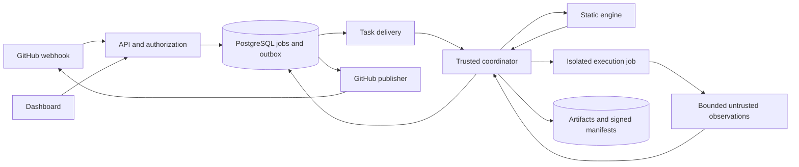

# RepoShield product and build plan

> SUPERSEDED: This earlier plan underweighted controlled agent execution. Use `REPOSHIELD_MASTER_PLAN.md`, `BUILD_TASKS_V2.md`, `COST_ESTIMATE.md`, and the current `CODEX_BUILD_BRIEF.md`. The updated plan includes both modes and the confirmed solo-builder, 4–5 week deadline. Retained here only for background research and longer-term ideas.

Prepared 10 October 2026 from the local prototype, README, roadmap, security notes, synopsis, and selected source and test files. This is a proposed implementation specification, not a claim that the commercial features exist. Start implementation with `IMPLEMENTATION_BACKLOG.md` and `CODEX_BUILD_BRIEF.md` in this directory.

## 1. Product decision

Build RepoShield as a GitHub merge verification product for Python teams: it explains which architectural rules a change violates, whether tests were weakened, which tests were selected and why, and what evidence supports the merge decision. It should work on human and AI contributions alike; attempting to detect whether code was AI generated is unnecessary.

The first buyer hypothesis is an engineering lead at a small SaaS company or development agency with 5–30 developers, Python services, GitHub pull requests, and an existing pytest suite. The user is the developer or reviewer; the budget owner is the engineering lead or founder. Validate this segment before treating it as established demand.

Suggested product description: **RepoShield checks repository rules and test evidence before changes merge, and shows reviewers exactly why a change passes or needs attention.**

The product's value should come from project-specific architectural constraints, test-integrity checks, conservative impact analysis, and attributable evidence in one workflow. A generic security scanner or AI review chatbot is a much less distinctive starting point. Semgrep already offers code, dependency, and secret security products, so integrate mature scanners later rather than attempt to replace them. This is positioning based on an initial competitive review, not proof of a unique market. [Semgrep platform](https://semgrep.dev/products/semgrep-appsec-platform/)

Important language corrections for the synopsis and eventual website:

- Say **estimated impact under supported analysis assumptions**, rather than exact blast radius.
- Say **mandatory configured checks passed for these inputs**, rather than code is safe or bug free.
- Say **conservative test selection with full-suite fallback**, rather than only tests that can be affected.
- Distinguish deterministic decision aggregation from nondeterministic test execution, flakes, external services, and environment differences.
- Say **audit integrity verified against a trusted checkpoint** only after implementing that checkpoint.
- Treat the existing 12 seeded bugs and nine test files as prototype evidence, not production accuracy statistics.

## 2. What exists and what to preserve

| Area | Evidence in this checkout | Main production gap |
|---|---|---|
| Python analysis | `analyzer.py`, `graph.py`, incremental graph and reverse impact | Explicit supported syntax, uncertainty, reproducibility, larger evaluation |
| Policies | `policy.py`, base-branch policy loading in `engine.py` | Schema evolution, enrollment rules, approved changes, administrative controls |
| Integrity checks | `checks.py`, syntax, secrets, dependency changes, test edits | Precision measurement, suppressions, mature scanner integration |
| Test selection | `selector.py`, coverage maps | Trusted and fresh baselines; shadow comparison against full suite |
| Execution | `sandbox.py`, Docker runner files, developer subprocess backend | Real Linux validation, separate trust domains, dependency preparation |
| Decisions and reports | `verdict.py`, `report.py`, `audit.py` | Authenticated artifacts, immutable attempts, independently anchored audit |
| Service | FastAPI, SQLite jobs, threads, shared API credential | Accounts, tenant separation, durable job delivery, recovery |
| GitHub | Signed webhook, commit statuses, comments, Action template | GitHub App, Checks, current-revision gating, lifecycle management |
| Action gateway | `actions.py` | Separate trust boundary and genuine enforcement; defer from initial product |

Keep the Python engine and CLI. Refactor through tested interfaces rather than discard working algorithms. Keep the simple HTML report as a portable export even after adding the dashboard. Preserve the existing ten-scenario demo as a regression fixture.

The local folder does not show a top-level `.git` directory in this inspection. Confirm the intended source repository and establish version control before implementation; do not assume this copied prototype has recoverable Git history.

Specific risks observed during source inspection that need regression tests in the first milestone:

1. `_finalize_required` checks for missing and failed test records, but the displayed logic does not require a passing outcome for skipped or expected-failure records. Required-test semantics need to be explicit.
2. Cached runs are reused after checking the event chain, without visibly authenticating the separate `result.json` bytes. Bind the actual evidence and result hashes to a trusted manifest.
3. The cache identity includes several inputs but omits trust-related options such as `require_tests` and `untrusted_code`, and does not identify an immutable runner image. Different assurance requirements must not share an eligible verdict accidentally.
4. `verify_chain` checks internal links; a self-consistent truncated or entirely rewritten log can still validate without an expected head hash and event count stored elsewhere.
5. Webhook delivery deduplication and run creation occur as separate database operations. A crash between them can lose work. Store the delivery and queued intent atomically.
6. GitHub reporting errors are logged and swallowed. Persist publication intent and retry it separately so a completed internal run does not remain indefinitely pending in GitHub.
7. Per-repository locks are process-local. They do not prevent separate workers or CLI processes from competing over deterministic run directories or shared caches.
8. The Action template contains a placeholder installation URL, mutable action tags, and `pip install ... || true`. It is a prototype integration; dependency setup failure must prevent a successful verification.

These are planning observations from selected code paths, not an exhaustive security audit. Do not silently fix them during planning; implementation should add reproductions first.

Baseline validation on 10 October 2026: the existing suite completed with **111 passed, 1 skipped in 61.21 seconds**, using the local Python 3.10 interpreter and `python -m pytest -q --tb=line --basetemp=C:/Users/pjpra/Desktop/reposhield/.test-baseline-20261010-02`. Earlier attempts hit temporary-directory/Git configuration permission failures; the successful run used an approved execution context and a fresh project-local temporary directory. The suite emitted a pytest-asyncio fixture-loop-scope deprecation warning. This validates the existing suite in this environment, not a live GitHub installation or production Docker isolation. Prototype application code was not changed during this planning review.

The synopsis claims Windows Docker validation while README/security notes describe end-to-end Docker execution as unverified. Reconcile with dated, reproducible Linux and Windows development evidence. A sandbox self-test and a complete repository verification are different tests.

## 3. Scope and delivery boundaries

| Release | Include | Exit condition |
|---|---|---|
| Final-year release | Reliable CLI, Python engine, Linux execution, GitHub App, single-team dashboard, policies, reports, real evaluation | Another person installs it and reproduces the demo and evaluation |
| Private commercial beta | Tenant isolation, durable service, customer-controlled execution, onboarding, quotas, backups, support, usage accounting | 3–5 design partners use it repeatedly; at least two agree to pay |
| Public paid release | Proven authorization, billing, retention/deletion, restore drill, operational monitoring, explicit support boundaries | Reliability and economic gates below met |
| Later expansion | TypeScript adapter, deeper coverage selection, enterprise identity, hosted hostile-code execution | Repeated paid customer demand justifies each investment |

For the first useful release, support Python and pytest, GitHub, Linux execution, and repositories whose tests can run without production secrets or unrestricted network. Windows is a development and CLI compatibility target, not the first production runner target. Support one repository root initially; detect unsupported monorepo arrangements and explain the limitation.

Do not put Kubernetes, a graph database, multi-cloud operation, a custom identity server, Java analysis, IDE extensions, automatic fixes, MCP integration, or an agent command gateway on the critical path. None is necessary to prove the first product's value.

## 4. User journey and product requirements

1. A maintainer signs in through GitHub and installs the App on selected repositories. Explain requested permissions and source-code handling before installation.
2. RepoShield checks repository language, test command, dependency lock, branch, and execution compatibility. Unsupported setup yields a useful diagnostic rather than a false green result.
3. The maintainer selects a policy template and reviews a proposed configuration change. Initial policy enrollment requires an authorized maintainer; a PR cannot authorize its own policy.
4. Run in observation mode for about two weeks. Show findings and compare predicted selection with full tests. Observation does not satisfy an enforced merge gate.
5. On each PR update, publish progress, policy findings, affected paths, test plan, execution evidence, and the final result for the precise revision.
6. The reviewer opens a run page, sees the main reason immediately, and follows an evidence path such as `payments/refund.py → common/money.py → analytics/client.py`.
7. After reviewing noise and missed dependencies, the maintainer enables a required `RepoShield / gate` check. Only then may it block merges.
8. The maintainer can rerun an attempt, request a narrowly scoped exception, inspect history, remove the repository, or delete retained data.

Dashboard pages:

| Page | Required behavior |
|---|---|
| Setup | Installation state, repo selection, permissions explanation, runner connectivity, first-run progress |
| Repository overview | Latest revision status, recent runs, rule configuration, measured timing and fallback rate |
| Run detail | Verdict first; findings with locations; test plan and reasons; graph path; actual isolation properties; logs and artifacts |
| Policy | Effective trusted version, validation errors, templates, proposed changes, approval history |
| Team settings | Owner, maintainer, viewer; membership; runner credentials; retention; audit events |
| Operations | Failed setup, stalled jobs, retry state, queue delay, installation revoked, quota exhausted |

Use text and icons alongside colors. Include loading, empty, failure, expired artifact, stale revision, and insufficient-permission states. The graph supplements the explanation; the reviewer should not need to understand the graph to act. Avoid decorative security scores without a validated interpretation.

## 5. Recommended implementation stack

These are architecture choices for this project. Pin tested versions when implementation begins; this document does not claim every package's latest version.

| Component | Choice | Reason |
|---|---|---|
| Core and API | Python 3.12 baseline, FastAPI, Pydantic | Reuses existing code and provides typed request and result schemas |
| Persistence | PostgreSQL, SQLAlchemy, Alembic | Transactions, migrations, tenant-aware relational data |
| Background delivery | Celery with Redis broker; PostgreSQL owns job state | Separate slow execution from web requests; retries are explicit |
| Browser application | React, TypeScript, Vite, React Router | A dashboard does not need a second server-side web framework |
| UI | Tailwind CSS, accessible component primitives, TanStack Query | Consistent styling and predictable API state |
| Graph view | Cytoscape.js, loaded only on run detail | Interactive dependency paths without a graph database |
| Artifact storage | S3-compatible object storage | Separate large logs/reports from relational records |
| Integration | GitHub App, installation tokens, Checks API | Repository-scoped integration with lifecycle handling |
| Execution | Dedicated Linux execution host for controlled beta; ephemeral VM per untrusted job for hosted expansion | Separate customer code from the API and credentials |
| Development | Docker Compose for API/database/broker/UI dependencies | Repeatable local setup |
| Tests | pytest, Hypothesis, browser tests with Playwright | Preserve algorithms, test invariants and complete user flows |
| CI and operations | GitHub Actions, structured logs, OpenTelemetry-compatible instrumentation | Reproducible releases and diagnosable failures |

FastAPI and Vite are established fits for the proposed API and client structure. Celery tasks must be designed as idempotent: retries do not confer exactly-once execution. [FastAPI](https://fastapi.tiangolo.com/), [Vite guide](https://vite.dev/guide/), [Celery task guidance](https://docs.celeryq.dev/en/stable/userguide/tasks.html)

Start with GitHub sign-in and server-managed secure cookies; do not build passwords. Verify workspace membership on every API call. GitHub App installation ownership and dashboard login are separate concepts and must be linked explicitly. Add enterprise OIDC/SSO only after demand.

Keep one repository and a modular backend. Suggested additions: `web/`, `reposhield/server/auth/`, `reposhield/server/jobs/`, `reposhield/server/integrations/`, `reposhield/execution/`, `migrations/`, `schemas/`, `infra/`, and `tests/security/`. Avoid a disruptive mass file move before behavior is covered.

## 6. Architecture and execution trust

The API authenticates, authorizes, stores intent, and serves results. It never runs repository commands. The trusted coordinator owns immutable inputs and final aggregation. The execution environment receives repository material and a bounded job specification, but no GitHub App key, cloud administration credential, database credential, signing key, or Docker socket.

Recommended commercial entry: customer-controlled, dedicated ephemeral execution with a hosted coordination dashboard. For student demonstrations use your own dedicated runner and known demo repos. Existing CI output can be attached as evidence, but editable PR workflow output is not automatically trusted enough to satisfy the gate. A trusted coordinator must validate source, job identity, environment and input hashes. Document that a customer controlling their runner can forge their own evidence; this does not justify cross-tenant trust.

For fully hosted untrusted code, initially choose ephemeral VMs with one job per VM and no shared writable customer state. Evaluate gVisor later if its performance and compatibility fit. gVisor provides an additional isolation layer; it is not a micro-VM and should not be described as one. [gVisor security architecture](https://gvisor.dev/docs/architecture_guide/intro/)

Dependency installation is code execution too. Prepare dependencies in isolated jobs using pinned lockfiles, restricted package egress, quotas, and no platform secrets. Disable network for test execution by default. A changed lockfile builds a new environment; never reuse another tenant's writable dependency cache. If dependencies cannot be prepared, report a setup failure. Explicitly unsupported integration tests remain incomplete evidence.

Use trusted runner images pinned by digest. Bound repository size, Git object processing, parser depth, files, memory, CPUs, PIDs, disk, runtime, and output. Disable unneeded submodules, hooks and LFS behavior by default. Reject unsafe archive paths, symlinks and special files at the boundary. Treat logs, reports, coverage databases and HTML as hostile inputs; parse them in a limited process and escape output.

Reporter limitation: placing a collector outside the test process prevents some artifact replacement but does not prove that arbitrary Python code executed genuine assertions. Tests can manipulate pytest, skip work or exit deliberately. Preserve trusted expected test identities where practical, compare collection and outcomes, flag test/config changes, and retain independent runner observations. State the remaining limitation rather than promise an unforgeable test oracle.

## 7. Verification contract

Version every result schema. A run records workspace and repository identity; base tip SHA; diff merge-base SHA; PR head SHA; execution tree SHA; trusted policy hash and provenance; analyzer/checker versions; dependency digest; runner image digest; selection and trust modes; evidence requirements; and limits.

Distinguish three comparisons: PR changes normally use merge-base to head; policies use the trusted target branch or approved policy revision; final integration testing uses the current merge candidate when available. If merge-candidate execution is unavailable, label the run as head-only and require an up-to-date branch before merge. A changed target branch or policy invalidates the applicable gate. Do not imply that testing an old head against an old base validates today's merge.

Maintain independent fields:

- `status`: queued, preparing, analyzing, executing, finalizing, completed, errored, cancelled, superseded.
- `verdict`: PASS, BLOCK, REVIEW_REQUIRED, or null when there is no completed decision.
- `evidence_status`: complete, partial, missing, or invalid.
- `publication_status`: pending, published, retrying, or failed.

PASS means all applicable mandatory requirements have acceptable evidence for the specified inputs. BLOCK means a blocking condition exists. REVIEW_REQUIRED means policy requests review or required evidence is incomplete. Infrastructure errors never manufacture a PASS. A legitimate trusted docs-only policy can mark tests not applicable, but broad file ignores must not hide executable or build inputs.

Required-test rules must define how skips, xfails, xpasses, deselection, collection failures and zero tests behave. Default: skipped, missing and expected-failure tests do not meet a requirement for a passing test. Missing coverage or unresolved dependencies cause full-suite fallback; if that suite cannot run, return incomplete evidence.

Keep `safe` as the default selection strategy but describe its assumptions. Initially perform selection in shadow mode while running the full suite. Enable reduced execution per repository only after validation, preserving periodic full-suite runs and immediate fallback on uncertain changes. Keep `balanced` experimental until larger evidence supports it.

Separate an immutable result identity from a unique execution-attempt ID. Concurrent requests may reuse verified content-addressed artifacts but must not overwrite an active run directory. Fresh test reruns produce new attempts. Cache keys include all decision-affecting and trust-affecting inputs; authorize cache reads within the tenant and validate signed artifact manifests.

## 8. GitHub enforcement

Use installation tokens scoped to the repositories and operations needed. Initial permissions: metadata read, contents read, pull requests read, checks write. Request pull-request write only if comments are enabled. Do not request content write merely to show a policy suggestion. Installation access tokens are the intended App authentication mechanism. [GitHub installation authentication](https://docs.github.com/en/apps/creating-github-apps/authenticating-with-a-github-app/authenticating-as-a-github-app-installation)

Validate webhook signatures over bounded raw bodies. In one database transaction, store delivery identity, normalized event, run intent and an outbox record. Return promptly after durable acceptance. A dispatcher retries delivery to the task queue; duplicate tasks are safe. Handle installation removal, repository access removal, PR synchronization, close/reopen, base change, and explicit reruns.

Publish separate `RepoShield / observe` and `RepoShield / gate` checks. The former is informational and never configured as the enforced gate. For the gate: PASS maps to success; BLOCK and unresolved REVIEW_REQUIRED map to failure with distinct explanations. Errors and cancellations stay non-successful. Pin the required check to the expected App where supported and test actual branch settings.

Never map unresolved review to `neutral` or `skipped`: GitHub permits successful, neutral or skipped required checks. Check the real protected branch behavior with a test PR before claiming enforcement works. [Protected branches](https://docs.github.com/en/repositories/configuring-branches-and-merges-in-your-repository/managing-protected-branches/about-protected-branches)

Use the Checks API for run summaries and bounded line annotations, with a dashboard link for complete evidence. Keep comment updates optional to avoid notification noise. Persist outbound updates in an outbox with backoff, rate-limit awareness and retry visibility. [GitHub Checks API](https://docs.github.com/en/rest/checks/runs)

Review approvals are separate immutable records, bound to revision, policy and finding IDs, with actor and reason. A fresh commit invalidates approval. Do not rewrite a raw REVIEW_REQUIRED result as PASS; derive the effective gate from evidence plus any permitted approval. Non-overridable findings remain blocked. Defer exception workflows if they cannot be implemented safely in the student release.

When merge queues are enabled, implement and validate `merge_group` handling or explicitly mark them unsupported. Do not announce merge queue support after testing only PR webhooks. Keep untrusted PR execution out of credential-bearing privileged workflows and pin external actions to reviewed commit SHAs. [GitHub Actions security guidance](https://docs.github.com/en/actions/reference/security/secure-use)

## 9. Data and API specification

Use UUIDs, UTC timestamps, schema versions and explicit workspace IDs. Core tables:

| Entity | Main contents |
|---|---|
| users and workspaces | GitHub identity, workspace name, lifecycle |
| memberships | Workspace, user, role, status; unique pair |
| installations and repositories | GitHub IDs, access status, workspace, configured branch |
| policy_versions | Content digest, trusted source, approval, activation |
| webhook_deliveries | Installation, delivery ID, payload digest, accepted status |
| runs and run_attempts | Immutable input identity, state, verdict, timing, lease and attempt |
| findings and test_plans | Rule, outcome, location, explanation, selected tests and reasons |
| test_results and artifacts | Outcomes, digests, sizes, storage references, retention |
| approvals and audit_events | Actor, scope, revision, reason, signed checkpoint reference |
| outbox_events | Task/publication payload reference, attempts, next retry time |
| runner_registrations and usage_records | Workspace-scoped runner identity, revocation, metered usage |

Use foreign keys and unique constraints for installation/delivery deduplication and attempt ownership. Tenant scoping belongs in the service/repository layer, with cross-tenant tests; PostgreSQL row-level security can add defense in depth. Do not accept an arbitrary workspace ID as authorization.

Proposed API surface:

| Route | Contract |
|---|---|
| `POST /webhooks/github` | Signed, idempotent event intake |
| `GET /api/v1/me` | Session and authorized workspaces |
| `GET /api/v1/workspaces/{id}/repositories` | Paginated authorized list |
| `POST /api/v1/repositories/{id}/runs` | Authorized immutable-revision run; idempotency key |
| `GET /api/v1/runs/{id}` | Status, fingerprint, verdict and evidence summary |
| `GET /api/v1/runs/{id}/findings` | Paginated findings |
| `GET /api/v1/runs/{id}/test-plan` | Selection reasons and fallback explanation |
| `GET /api/v1/runs/{id}/artifacts/{artifact_id}` | Authorized download or short-lived scoped URL |
| `POST /api/v1/runs/{id}/reruns` | New attempt; old evidence unchanged |
| `POST /api/v1/runs/{id}/approvals` | Later: scoped maintainer approval with reason |
| `POST /api/v1/repositories/{id}/policy-validation` | Syntax/semantic validation, no activation |
| `GET /health/live` and `/health/ready` | Process and dependency readiness |

Cloud APIs must not accept arbitrary local filesystem paths. Retain local-path verification only in the explicitly local developer mode. Use pagination, request bounds, documented error codes and OpenAPI contract tests. Poll for run progress initially; add server-sent events only if needed.

## 10. Evidence and operations

Create a canonical manifest with input fingerprint, hashes and sizes of result, report, test evidence and events, final audit head, event count, producer identity and key ID. Sign it outside the untrusted runner. Store its expected identity in the control plane or an independently protected append-only store. Reverify before cache reuse and downloads. Plan key rotation and retain verification keys.

A signed result proves origin and integrity under the stated key trust; it does not prove that tests are semantically honest. Hash chains alone do not provide immutable storage. Avoid calling this blockchain or compliance certification.

Operational minimum: job heartbeats and leases, bounded retries, cancellation cleanup, per-workspace concurrency and minute quotas, dead-letter inspection, redacted structured logs, request/run correlation, and alerts for stalled jobs or failed GitHub publishing. A worker crash must leave an identifiable retryable attempt, not a silent green result.

Suggested beta objectives, to be measured rather than advertised immediately: durable webhook acceptance p95 below two seconds; control-plane overhead p95 below ten seconds on small supported repositories, excluding preparation/tests/queue; 99% of supported jobs reach a terminal state without operator intervention during the observation period. Track user-code failures separately from service failures.

Use encrypted transport and storage, centralized secrets, private database/broker access and separate execution credentials. Proposed defaults: delete execution workspaces immediately after jobs, retain redacted logs seven days and structured evidence thirty days. Let customers inspect the retention policy; implement deletion on uninstall/request and document backup expiry. Do not send source code to an LLM by default.

Before paid launch, perform a real backup restore, verify deletion and credential revocation, write incident and key-rotation runbooks, and have someone other than the implementer review tenant authorization and execution isolation. These are product reliability gates, not claims of certification.

## 11. Evaluation and final-year contribution

Research question: **How much test execution can dependency-based selection save while retaining detection of observed regressions, and can trusted policies expose architectural and test-integrity violations that ordinary passing tests miss?**

Compare full-suite execution, filename-based selection, static dependency selection, and experimental coverage-assisted selection. Keep runtime image, dependency locks, machine limits and commit revisions fixed. Separate cold preparation, warm preparation, analysis, execution, total wall time and actual billed compute. Running fewer files is not equivalent to the same percentage speedup.

Target 5–10 license-compatible Python repositories across sizes, at least 100 reproducible change scenarios overall, and both seeded mutations and real historical regressions where available. These are proposed evaluation targets, not existing results. Separate development fixtures from held-out evaluation cases. Record excluded or unbuildable commits and flaky tests.

Measure test count and duration reduction, regressions detected by each selector relative to the full suite, selection misses, fallback frequency, policy precision by manual adjudication, setup success, review burden, and incremental/full graph equality. Full-suite success itself is not proof of correctness. Publish denominators, raw data, environment fingerprints and uncertainty; never imply zero observed misses proves zero risk.

Security regression scenarios include policy edits, skipped required tests, forged artifacts, truncated logs, wrong-tenant artifact access, duplicate webhooks, worker loss, old-head result publication, invalid runner credentials, dependency installation failure, excessive output, secret logging and malicious archive entries.

Final-year submission should include architecture and threat model, algorithm explanation and complexity, API/data design, test report, reproducible evaluation, limitations, installation guide, eight-minute demo and future work. The contribution is the implemented integration and evaluated behavior; do not claim to invent dependency graphs or regression test selection.

## 12. Timeline and team plan

Assumption: one student with roughly 20–25 focused hours a week, using coding assistance, and basic Python/web skills. Estimate 16–20 weeks to a strong final-year release/private pilot; commercial maturity may require several additional months. These are planning ranges, not a completion guarantee. If the deadline is shorter, reduce scope to CLI, one GitHub installation, basic dashboard, and evaluation.

| Weeks | Deliverable | Release gate |
|---|---|---|
| 1–2 | Reproduce prototype, fix evidence/decision defects, define schemas and threat model | Verified baseline and regression tests |
| 3–4 | Trusted Linux runner and dependency preparation | Real isolated demo execution; failure cannot pass |
| 5–6 | GitHub App vertical slice and real branch gate | Safe, blocked, review and error PRs behave correctly |
| 7–8 | PostgreSQL jobs/outbox, recovery and artifact integrity | Duplicates/crashes recover without false success |
| 9–10 | Sign-in, workspace authorization, functional dashboard | Two workspaces cannot access each other's objects |
| 11–12 | Policy onboarding and observation mode; design partner setup | Another maintainer installs without live guidance |
| 13–14 | Real repository evaluation and performance fixes | Reproducible comparative results |
| 15–16 | Documentation, demo, deployment and recovery drills | Final-year release candidate |
| 17–20 | Pilot corrections, quotas, metering and paid-beta readiness | Usage and willingness-to-pay evidence |

Run customer discovery from week one. Reserve about 25% of time for debugging, evaluation and documentation. If behind schedule, defer billing automation and policy UI polish before cutting isolation, truthful verdicts or evidence integrity.

## 13. Business validation and economics

Interview 10–15 engineering leads. Ask for a recent problematic PR, the time spent reviewing it, how architecture rules are enforced, whether tests are ever weakened, and what existing tools failed to explain. Observe their real workflow; do not lead with a feature pitch. Recruit 3–5 teams willing to run observation mode and review findings weekly.

Useful early gates: three teams use the product for four consecutive weeks; maintainers identify specific actionable findings; installation takes under thirty minutes for the supported setup; actionable findings are not swamped by false positives; two teams agree to pay for continued use. If teams value test-integrity checks more than selective execution, narrow the product accordingly. If nobody will install or pay, reassess before adding languages.

Offer an open-source local CLI and a paid coordination service as a licensing hypothesis. First check that you own the prototype and dependencies permit distribution; the visible top-level inventory did not include a LICENSE file. Choose a deliberate license before public release. Keep pricing tied to repositories and verification usage, not to the number of scary findings.

Proposed pricing experiments, not market benchmarks: free local use; a $29–$59/month small-team plan using customer execution; a $99–$199/month team plan with more repositories, retention and controls. Hosted execution needs included-minute caps and overage economics, never unlimited compute. Start with manually managed paid pilots before a complex billing implementation.

Planning budget assumptions, not vendor quotes: local development $0–$30/month incremental; a small private beta $50–$150/month for API, database, broker, storage and monitoring, excluding hosted test compute, taxes and your labor. Validate provider prices before purchase. Run disposable production test jobs only after setting spend caps.

Unit-cost model: `runs × average execution minutes × all-in cost per minute + allocated control-plane/storage cost + support cost`. Example assumptions: 2,000 runs × 3 minutes × $0.01/minute = $60 execution alone. With $20 infrastructure allocation, a $99 plan leaves $19 before support and payment costs. This is why customer execution or carefully metered hosted usage is the recommended starting point.

Distribution: publish the CLI, a clear quickstart and reproducible ten-PR demo; write evidence-based case studies; approach Python maintainers and small engineering teams directly; use a GitHub Marketplace listing after installation and support are dependable. Do not buy advertising before retention is demonstrated.

The likely defensibility is trusted workflow integration, useful policies, accumulated permissioned evaluation fixtures, reliable execution and low reviewer burden. It is not the presence of an LLM. Maintain a competitor review before launch; this initial research is not an exhaustive market analysis.

## 14. Later investments and decision rules

Add TypeScript only when several active customers need it and the Python pipeline is stable. Define analyzer outputs now so an adapter can emit files, imports, uncertainty and tests later; do not build a plugin marketplace first.

Add per-test coverage selection after held-out shadow evaluation supports it. Keep environment and test configuration bound to the baseline; stale baselines trigger fallback. Symbol-level analysis should solve measured imprecision, not serve as a complexity badge.

An optional LLM can explain sanitized structured findings or draft a proposed policy. Its output is labeled commentary, stored separately, has no authority to alter verdicts, never receives credentials, and is disabled by default for private source. No GPU, model training, vector database or model API is needed for the core product.

Revisit agent action authorization only with an enforced separate execution boundary; a command wrapper an agent can bypass is not a security control. Consider enterprise SSO, audit exports and hosted execution only after paid pilots expose the requirement.

## 15. Definition of complete

A new maintainer can install the product, configure a trusted policy, see a real PR pass or block on GitHub, understand the evidence, rerun safely, and remove their data. Results remain tied to exact revisions. Missing evidence, unavailable execution, stale results and service failures cannot unlock the merge gate. The supported Python workflow has reproducible evaluation, a documented operating cost, and a maintainer willing to use it again.

That is a complete first product. Broad language coverage and enterprise procurement features can follow after this foundation earns real usage.
