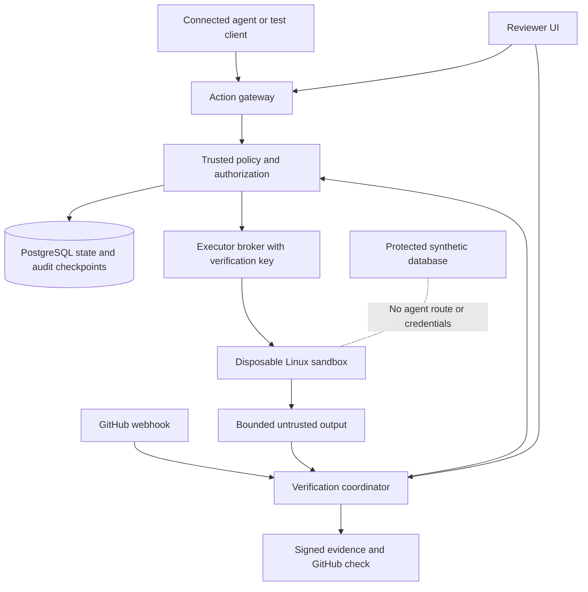

# RepoShield verification and controlled execution plan

Version 2, 10 October 2026. This is the authoritative plan for the next release. It supersedes the earlier PR-focused `PRODUCT_BUILD_PLAN.md` and `IMPLEMENTATION_BACKLOG.md`. Read together with `BUILD_TASKS_V2.md`, `COST_ESTIMATE.md`, and `CODEX_BUILD_BRIEF.md`.

## 1. Your objective and actual constraints

RepoShield independently verifies changes proposed by AI coding agents and controls which actions a connected agent may execute. It enforces explicit organizational rules, requires evidence before admitting a change, denies unauthorized operations, limits execution privileges, and records decisions for review.

Your original ACV research explicitly describes both modes in sections 32–37. We are retaining both as first-release requirements. The product brand and CLI remain RepoShield; retain `.reposhield.yml` rather than rename the working prototype to ACV. The original research is preserved in `ACV_ORIGINAL_RESEARCH.md` for traceability, not as a second competing implementation specification.

Confirmed constraints: one active developer, a 16 GB laptop, four people sharing any costs, and submission in 4–5 weeks. From 10 October that is approximately 7–14 November 2026; confirm the actual institution deadline. Do not mistake four contributors to expenses for four engineers. Plan approximately 110–145 focused hours including testing, documentation, demonstration and contingency. If fewer hours are available, use the scope cuts below, while preserving both modes.

The deliverable is a complete, narrow final-year release and a credible foundation for a business. It is not a public multi-tenant security service ready to protect arbitrary companies within five weeks.

## 2. What the product can honestly promise

**RepoShield verifies AI-proposed code changes and mediates connected agent actions using explicit policies, restricted execution, and auditable evidence.**

Safe means the configured controls and evidence requirements were satisfied under the documented threat model. Right means checked against requirements and tests, not universally correct. Ethical means compliance with explicit rules such as no unauthorized access, no customer-data export and no production modifications without approved authority; there is no general-purpose ethics classifier.

The boundary is connected, controlled agent sessions and protected GitHub branches. RepoShield cannot protect a production database if an agent has independent administrator credentials and a separate route around RepoShield. Ordinary use of a desktop coding agent outside that boundary remains unprotected. The UI must distinguish `VERIFICATION ONLY`, `CONTROLLED SESSION`, and `DEVELOPMENT EXECUTION` clearly.

PASS applies to a specific change and configuration. ALLOW applies to a specific action in a particular execution environment. Neither means every future action is permitted or the software is bug free.

## 3. Two mandatory product modes

| Mode | Input | Decision | Enforcement |
|---|---|---|---|
| Change verification | Immutable Git base/head and trusted policy | PASS, BLOCK, REVIEW_REQUIRED | Required GitHub check and CLI exit status |
| Controlled execution | Authenticated session and structured action | ALLOW, DENY, REVIEW_REQUIRED | Separate executor validates authorization and applies OS/network/resource controls |

Maintain separate execution states such as queued, running, completed, failed-infrastructure, cancelled and unknown-outcome. An infrastructure failure must not be reported as a successful verification or a completed action.

Do not merge the two decisions into a vague numerical safety score. A session may have an allowed test action, a denied database action, and a blocked code change; show all three correctly.

## 4. What already exists

The prototype supplies Python AST analysis, incremental dependency graphs, impact traversal, policy checks, test selection, Docker command construction, reports, a CLI, signed action tokens, a hash chain, and a basic FastAPI/SQLite/GitHub service. Preserve and improve these.

The prior planning review ran the current suite successfully: 111 passed, one skipped, in 61.21 seconds on local Python 3.10 after resolving test temporary-directory permissions. This is a historical baseline, not proof of live GitHub enforcement or Docker isolation. Rerun after changes in a clean environment.

Required early fixes from source inspection:

- Required-test handling must not treat a file containing only skipped/expected-failure tests as satisfying a passing-test requirement.
- Cached result bytes need integrity validation; an internally valid event chain does not authenticate separate mutable JSON.
- Fingerprints must include assurance mode, evidence requirements, immutable runner image and all decision-affecting inputs.
- An audit chain needs a separately trusted expected head/count to detect truncation or replacement.
- The current action nonce file is checked and appended non-atomically; simultaneous replay needs a transactional claim.
- Gateway keys must leave the repository/agent workspace. Production executors must not possess the private signing key.
- Command-name prefixes and wildcard allowlists are not proof that an interpreter or pytest will behave harmlessly.
- Path confinement must resolve links and filesystem identity safely, not rely on a string prefix.
- Webhook deduplication and queued intent need a single transaction; GitHub publishing needs durable retries.

Record reproductions before fixing these; the list is not a complete audit.

## 5. Five-week release scope

| Must ship | Minimal implementation |
|---|---|
| Python verification | Existing engine with decision/cache fixes and conservative fallback |
| Trusted policy | Base-branch rules plus administrator-owned action restrictions |
| Controlled actions | Read file, apply patch, run approved test task; deny unrestricted network and production operations |
| Signed decisions | Canonical action, short expiration, identity/policy/workspace binding, atomic single-use claim |
| Real isolation | Linux environment, no host credentials/socket, resource/time/output limits, test-stage network denied |
| Dangerous-operation demo | Synthetic protected database survives both an explicit denied request and a direct-access attempt |
| Durable runs | PostgreSQL jobs/attempts/events, one or two workers, restart/replay handling |
| GitHub | One real installation, signature validation, current-revision Check Run and real required-check demonstration |
| UI | Four functional views: repositories, run detail, controlled session/actions, policy/settings |
| Evidence | JSON/HTML reports, signed result manifest, audit verification and timeline |
| Evaluation | At least 20 code-change scenarios and 15 action/control scenarios; measured results |
| Packaging | Local setup, threat model, limits, reproducible demo and submission report |

Defer billing, enterprise SSO, self-service multi-tenant enrollment, Go rewrite, TypeScript analysis, coverage-pruned execution as default, symbol-level call graph, arbitrary SQL broker, production deployment actions, generalized network proxy, Kubernetes and LLM explanations.

A basic approval flow belongs in this release, but allow approval only for a defined low-risk operation or reviewable policy finding. Hard-denied production actions stay denied. This prevents an inexperienced reviewer from turning the demonstration into an unrestricted command executor.

## 6. Stack and why it differs from parts of the research

| Layer | Decision for this deadline |
|---|---|
| Core/API | Keep Python and FastAPI; use a pinned Python 3.12 Linux runtime after compatibility verification |
| Models | Pydantic request/result schemas; pure functions/dataclasses within algorithms where practical |
| Database | PostgreSQL, SQLAlchemy, Alembic; one small database |
| Job queue | PostgreSQL job table with transactional claims, leases and attempts; no Redis/Celery in this release |
| Worker | Separate Python process, bounded concurrency, persisted fixed-stage task dependencies |
| Frontend | React/TypeScript/Vite if the backend milestones are on time; existing HTML views are the fallback |
| Graph | Existing rendered graph first; interactive graph is optional polish |
| Signatures | Ed25519 via a maintained cryptographic library; versioned canonical payloads, key IDs, verification keys on executor |
| Execution | Docker Engine inside a dedicated Linux VM for demo/controlled pilot; fresh sandbox per task |
| Artifacts | Local protected directory initially; S3-compatible storage for remote retention later |
| Development | Docker Compose for trusted service dependencies; execution host separated from API |
| Testing | pytest, targeted property tests and a few end-to-end browser tests |

The original recommends Go but permits a compelling reason to change. The existing tested Python implementation and solo five-week deadline are that reason. Rewriting in Go creates a second implementation and consumes the schedule without establishing stronger controls.

The original also recommends Redis. PostgreSQL can supply this small release's durable job queue, avoiding another service and state boundary. Store state transitions explicitly; use row locking/conditional updates and transactionally publish job intent. Use `FOR UPDATE SKIP LOCKED` for queue claims with appropriate leases and fencing; PostgreSQL documents queue-like use as a suitable application of skipped locked rows. Add Redis delivery later if throughput measurements justify it. Do not claim PostgreSQL's presence automatically makes tasks exactly once. [PostgreSQL SELECT locking](https://www.postgresql.org/docs/current/sql-select.html)

Use a fixed small dependency DAG: snapshot → diff/graph → policies and test planning → isolated tests → aggregation → publication. Independent static checks can overlap once their prerequisites exist. Respect CPU/memory limits rather than launching four containers just because four workers are configured. Start with one test sandbox on the laptop.

## 7. Architecture and trust boundaries



Trusted services hold GitHub credentials, policy activation authority and private signing keys. The sandbox holds none of these. The executor broker can launch restricted jobs but cannot mint decisions. Treat the broker itself as trusted infrastructure, never as code inside the agent workspace.

A task credential permits only its own claim, heartbeat and bounded artifact submission; it cannot read organization data, change policy, enqueue arbitrary jobs or access the database directly. Reject customer-supplied resource URLs: resolve named resources from administrator-owned configuration.

For local development, use a disposable Linux execution VM with no personal/shared folders. On the 16 GB laptop, allocate roughly 4–6 GB to execution and 2–3 GB to trusted services, adjust from actual usage, and run a single sandbox. WSL/Docker Desktop is convenient for development but do not label a workspace with broad host integration as a hardened boundary. Disable host mounts/integration for hostile fixture tests. If memory is tight, use a short-lived remote runner during validation rather than buying hardware immediately.

One-host Compose can test wiring with known fixtures; it is not the deployment mode for untrusted customer execution. Before a real pilot, separate the runner host, deny its access to platform private networks and metadata endpoints, and make teardown/reset repeatable. Two VMs alone do not prove isolation: credentials, firewall rules, host integration and control channels still matter.

## 8. Controlled action contract

Use typed actions, not a general shell policy engine. Initial API examples:

```json
{
  "session_id": "session_123",
  "repository_id": "repo_123",
  "workspace_revision": "sha256:<manifest>",
  "action_type": "RUN_TESTS",
  "parameters": {"test_paths": ["tests/payments/test_refund.py"]},
  "requested_capabilities": ["workspace_read", "test_execute"]
}
```

This is a proposed schema, not an existing working endpoint. The broker constructs the executable and arguments from the trusted action implementation. A `test_execute` label does not make the executed Python code safe; sandbox restrictions enforce the boundary even when test code behaves maliciously.

Supported action behavior:

| Action | Rule |
|---|---|
| READ_FILE | Only an authorized repository snapshot and allowed paths; bounded output |
| APPLY_PATCH | Validate paths/size and expected revision; produce a new snapshot; protected paths require defined review or denial |
| RUN_TESTS | Trusted pytest invocation and image, authorized snapshot, network off, bounded resources |
| NETWORK_REQUEST | Denied in first release except trusted infrastructure operations outside the agent's authority |
| DATABASE_OPERATION | Production resource denied; no arbitrary SQL execution API in first release |
| EXECUTE_COMMAND | Legacy development compatibility only; secure mode accepts named task profiles, not arbitrary shell strings |

Any broader action type must return an explicit unsupported/denied decision. Keep verification tests working for supported projects; repositories needing unrestricted networking are not silently treated as supported.

Authorize using the intersection of administrator policy, trusted repository policy, session identity and resource capabilities. Repository policy may narrow administrator constraints, never enlarge them. Store an effective policy digest and revocation epoch.

The signed payload binds schema version, issuer/audience, tenant, repository, session/run, action digest, workspace revision, executable/profile and image digest, normalized paths, environment policy, limits, granted capabilities, policy digest/epoch, issue/expiry times and nonce. Explicit parameters, not just the displayed command string, are covered. Reject unknown schema versions, key IDs, invalid time windows and audience mismatch.

Execution sequence:

1. Authenticate the requester and check repository/session ownership.
2. Validate and canonicalize a bounded typed action.
3. Evaluate trusted policy; persist evidence for allow, deny or review.
4. For reviewable actions, obtain an authorized person's decision bound to the exact request; the agent cannot approve itself.
5. Sign a short-lived authorization for permitted actions.
6. Executor verifies signature, context, current policy/revocation state, and immutable snapshot.
7. Atomically claim the nonce and execution record through the trusted coordinator. Two requests cannot both claim it.
8. Execute against the claimed snapshot under the restricted profile. No writable race with later edits; a patch creates a new revision.
9. Capture bounded observations and finalize an immutable execution record.

If the broker crashes after consuming authorization but before persisting the result, mark the outcome unknown and reconcile. Do not blindly repeat side-effecting actions or claim exactly-once execution. Tests can be rerun as a new explicitly authorized attempt. Policy changes before claim invalidate old authorizations; revocation after start triggers best-effort cancellation but cannot undo effects already performed.

Use secure signing primitives from a maintained library, not custom cryptography. [Ed25519 signing documentation](https://cryptography.io/en/latest/hazmat/primitives/asymmetric/ed25519/)

## 9. What makes mediation effective

The connected agent must lack an alternative privileged tool path. Merely adding a RepoShield tool to an otherwise unrestricted coding assistant does not make that assistant controlled.

Ship a documented JSON/HTTP action client and a CLI adapter first. A deterministic scripted client can test the real authorization/execution path and is labeled as a scripted client. It does not fake policy decisions, database state or execution results. For the final demonstration, AI-generated code can be produced beforehand and submitted to the same real verifier.

If time allows, integrate one actual tool-calling agent through an adapter that exposes only these tools. Model credentials live in a trusted transport component, not repository execution. Do not promise compatibility with every agent or assume a subscription permits programmatic API access. Verify the chosen agent's supported interface before implementation. A real-agent adapter is useful evidence; it does not replace direct bypass tests.

Network-denied execution needs no LLM or paid model API. Optional explanations and live model calls remain outside the mandatory product path. This keeps the product independent of model availability and avoids spending on the wrong part of the system.

## 10. Database incident demonstration

Build a small e-commerce fixture with synthetic customers/orders and two separate resource identities: `staging_demo` and `protected_demo`. Both are disposable and clearly labeled synthetic. Never use real production data or credentials.

Demonstrate a permitted code edit and test run, then an explicit database-deletion request. The gateway denies the production-class resource. Next, run a bounded fixture that tries direct access from the sandbox; network and credential restrictions prevent reaching the protected database independently of the command label.

An independent trusted verifier records table existence, row count and a canonical content digest before and after. The protected database must remain unchanged. Show the denied action, the bypass-test result and the independent database check together. A printed DENIED message alone is insufficient evidence.

If adding a permitted staging-data read, implement one fixed broker operation with a non-owner read-only database role, bounded rows and timeouts; do not expose arbitrary SQL. PostgreSQL object owners have special authority, so a nominal read-only connection is not enough if the role owns the objects or can assume an owner role. [PostgreSQL privileges](https://www.postgresql.org/docs/current/ddl-priv.html)

The demo proves the configured boundary on these resources. It does not prove the system can understand or block every destructive intent in arbitrary code. Database backup/restore is a separate recovery control, not a substitute for prevention or a guarantee of rollback.

## 11. Verification and GitHub requirements

Keep the existing algorithms and conservative full-suite fallback. Distinguish import-edge direction: if A imports B, a change in B can affect A through reverse reachability. The original research's A→B→C example is ambiguous and should not be copied as an algorithm definition.

Confidence labels describe evidence quality, not calibrated probabilities. Do not use greedy coverage set selection to drop distinct tests merely because they cover the same lines. Tests can assert different properties. Use scheduling priorities to order required tests, not erase requirements.

Record base tip, merge base, PR head and execution tree separately. Read policy from trusted base/approved configuration. Bind results to the exact inputs and reject stale publication. If testing only head rather than a merge candidate, label that and require an up-to-date branch for enforcement.

Use a GitHub App with minimum needed permissions, bounded signed webhook processing and idempotent delivery. Persist webhook receipt and run intent atomically. Installation credentials never enter the sandbox. Keep publication attempts separate from verification state.

For enforced checks: PASS → success; BLOCK and unresolved REVIEW_REQUIRED → failure with clear explanations. Infrastructure error is non-success and visibly distinct. Never use neutral/skipped for unresolved required evidence, because those can satisfy required checks. Prove the actual branch cannot merge each non-success scenario. [GitHub protected branches](https://docs.github.com/en/repositories/configuring-branches-and-merges-in-your-repository/managing-protected-branches/about-protected-branches)

Use a public synthetic demo repository for free branch-protection availability. Private repository enforcement may need a paid GitHub plan; see the cost document. Do not automatically change branch protection without the repository administrator's explicit action.

## 12. Data model and API

Keep structured queryable fields and JSON only for bounded flexible evidence. Minimum tables: users, memberships, repositories, installations, policy_versions, deliveries, runs, attempts, tasks, findings, artifacts, sessions, action_requests, decisions, approvals, executions, audit_events and publication_outbox. Add graph/coverage snapshots keyed by repository/commit/analyzer; use content-addressed artifacts initially if migrating every graph node to relational rows delays the core.

Action tables include tenant/repository/session foreign keys, canonical digest, policy version, decision reason, expiration, nonce, claim state and outcome. Enforce a unique execution claim per decision/nonce with a transaction. Use unique delivery and logical-run identities, while allowing separate rerun attempts.

Core endpoints:

| Endpoint | Purpose |
|---|---|
| `POST /webhooks/github` | Signed event intake |
| `POST /api/v1/repositories/{id}/runs` | Authorized manual verification |
| `GET /api/v1/runs/{id}` | Status, verdict and fingerprint |
| `GET /api/v1/runs/{id}/events` | Audit timeline |
| `GET /api/v1/runs/{id}/artifacts/{artifact_id}` | Authorized evidence |
| `POST /api/v1/sessions` | Create controlled session with approved profile |
| `POST /api/v1/actions/authorize` | Evaluate exact structured action |
| `POST /api/v1/actions/{id}/approve` | Approve only explicitly reviewable requests |
| `POST /api/v1/actions/execute` | Validate and claim signed authorization |
| `POST /api/v1/sessions/{id}/revoke` | Deny future claims and request active-job termination |
| `GET /api/v1/sessions/{id}/events` | Decisions, executions and revocation evidence |

Secure every route on the server. For final-year use, support one organization with administrator/reviewer/viewer roles. Test cross-repository ownership despite the restricted onboarding scope. Do not advertise production multi-tenancy until cross-tenant isolation is independently reviewed.

## 13. Evidence and reporting

Store immutable attempts and a canonical manifest of result/artifact hashes, input fingerprint, event count and final audit head. Sign outside the sandbox; checkpoint in the trusted database. Verify before cache reuse. An altered, truncated or wrong-run bundle must fail verification. Private keys must not be in `.git`, the source tree, logs or test environments.

The sandbox's pytest report is an observation, not an unforgeable truth oracle. A malicious test can manipulate test execution and its own output. Validate schema, size, expected collection and process observations and report the residual limitation. External signing authenticates the captured evidence; it does not make false test output true.

The UI must show actual restrictions (network denied, image digest, timeout, workspace revision), not a generic safe badge. The session view shows attempted action, decision, policy reason, approving actor if any, execution outcome and evidence. Replay reconstructs history; it does not re-execute operations.

## 14. Calendar and scope control

| Week | Deliverable | Mandatory exit evidence |
|---|---|---|
| 1 | Baseline, schema/trust model, required-test/cache fixes, PostgreSQL run and action state | Existing suite plus focused regression tests; documented supported modes |
| 2 | Signed typed actions, atomic claim, isolated executor, synthetic database protection | Allowed task works; tamper/replay/bypass tests denied; protected DB unchanged |
| 3 | GitHub App vertical slice, durable worker, publication retries and stale-run protection | Real passing/blocked/review/error PR checks; worker restart and duplicate event tests |
| 4 | Four usable views, bounded human approval, audit export, benchmark scenarios, report draft | Complete local demo operated by another person; actual measurements |
| 5 if available | Fix failures, deployment rehearsal, restore/cleanup, final report and recorded demo | Release checklist, known limits and reproducible setup |

Aim for a complete local demonstration by the end of week three and a submission-ready release by the end of week four. Week five is contingency and hardening, not permission to add more scope. Do not postpone the database/action boundary until the last week.

If behind: keep the existing HTML dashboard rather than adding React; keep one organization and one worker; remove interactive graph polish, live LLM integration, staging-query convenience and optional coverage optimization. Do not remove controlled actions, real isolation checks, accurate verdicts, live GitHub validation or measured evidence.

## 15. Evaluation and final presentation

Minimum code suite: extend ten existing demo branches to at least 20 varied scenarios. Include transitive boundary crossings, changed tests, required-test skips, policy edits, dependency changes, unsupported dynamic behavior and actual regressions. Compare full suite, filename heuristic and conservative selector on fixed environments. Report runtime and misses, not only fewer tests.

Minimum action suite: absent token; altered parameters; expired token; different session; wrong tenant/repository; stale workspace; changed policy; simultaneous replay; protected path edit; direct database access; external network attempt; host secret access; quota excess; executor crash; session revocation. Include positive tests so a deny-everything system cannot pass evaluation.

Run real bounded Linux resource/isolation tests and sequential-versus-parallel scheduling measurements. If time permits, add 2–3 reproducible external Python repositories with compatible licenses/tests. Do not invent large-suite numbers from the research document; its 37/1,420 tests and timing examples are illustrative.

Suggested eight-minute demo: permitted edit and tests → code policy violation blocks PR → production-class database action denied → direct bypass attempt fails → database independently unchanged → token replay denied → corrected change passes → audit verifies → measured results and limits.

## 16. Business path after submission

Begin with Python/GitHub teams using agents and an existing test suite. Interview 5–10 leads during development if it does not derail implementation. After submission, recruit two design partners for isolated, customer-controlled pilots. Measure useful denials, false denials, time spent reviewing, installation effort, run costs and weekly return usage.

Sell explicit capabilities: controlled agent sessions, repository verification and evidence. Do not sell universal ethical judgment or guaranteed prevention of all breaches. Start with manually onboarded paid pilots; negotiate based on measured usage before committing to unlimited execution or a subscription price.

Commercial work after the deadline includes tenant isolation review, secure runner onboarding, tested account deletion/retention, independent security review, credential rotation, incident response, cost quotas and packaging. Hosted arbitrary-customer execution requires stronger isolation and operational evidence than the final-year demonstration. Billing and broader agent adapters follow retained usage.

## 17. Start instruction

Give Codex `CODEX_BUILD_BRIEF.md`. It directs implementation through the tasks in `BUILD_TASKS_V2.md`, starting with baseline and the two trust boundaries. No paid infrastructure or API is authorized by this plan. Use `COST_ESTIMATE.md` to choose a deployment profile only when it is actually needed.
